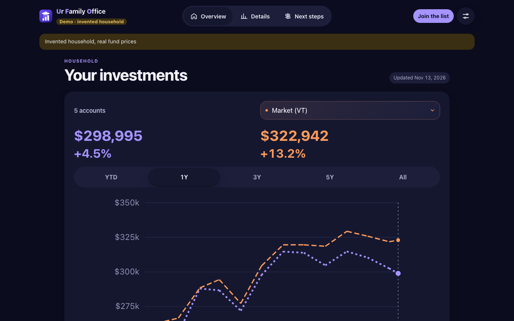

# Ur Family Office

**Understand your investments before deciding what to change.**

A personal finance product I designed and built, from brokerage-file imports and financial calculations to an interactive React dashboard and a public website.

[Explore the Plus household](https://simmyhundal.github.io/ur-family-office-site/plus-demo/) · [Try the free tool](https://simmyhundal.github.io/ur-family-office-site/try/) · [Website](https://simmyhundal.github.io/ur-family-office-site/)

<a href="https://simmyhundal.github.io/ur-family-office-site/plus-demo/"></a>

## The problem

A balance going up does not tell you whether your investments performed well. Deposits, withdrawals, different account types and incomplete statements make comparisons harder. UFO brings those accounts into one view and compares them with the same money invested in a benchmark.

The public Plus experience uses **invented accounts and public fund prices**. It is the same React interface as the local Plus pilot, with a small website adapter. It does not accept personal uploads, connect to a brokerage, move money or place orders. Personal file imports belong to Plus; commercial access remains early access.

## What you can explore

| Screen | What it helps answer |
| --- | --- |
| Overview | How much do I have? How did my cash-flow return compare with a benchmark? Where did the money come from? |
| Details | Which accounts contributed, and how do return, volatility and Sharpe compare? |
| Next steps | How did a Sharpe strategy behave across historical periods? What did it choose at past decisions, and what would a different allocation mean for an account? |

Choose benchmarks and time periods, inspect account histories, and walk through a strategy decision. Risk charts use time-weighted returns; Overview uses cash-flow IRR. They answer different questions. Historical strategy evidence, today's allocation replay and personal cash-flow illustrations are kept separate.

## Engineering choices

- **One product UI:** Overview, Details and Next steps compose shared React controls, charts, legends, disclosures and formatting. Portfolio and benchmark colours use semantic roles; estimation affects line style separately. The public household is data plus a wrapper, rather than a second dashboard implementation.
- **Python owns the financial calculations:** the local pipeline normalizes imported events, reconciles accounts and produces a typed report payload. React presents precomputed results. The public sample is generated from an invented registry through that pipeline.
- **Useful with imperfect data:** estimated history is labelled. Unknown holdings do not become invented portfolio weights. Independent public-fund research can continue when positions are missing; current-risk matching needs defensible inputs.
- **Inspect the evidence:** the walk-forward strategy chooses allocations using earlier prices, with matched-date benchmarks, dated decisions, drawdowns and rolling windows. Fund selection and historical substitutes still introduce limitations; a backtest is not a forecast.
- **Offline report, static hosting:** the generated Plus page contains its data and JavaScript. Opening and interacting with it requires no data requests. The free tool uses same-origin public price files; sign-up submits only explicitly provided contact information.
- **Incremental migration with recovery:** the Plus renderer has a legacy recovery path. React migration preserves the analytical payload rather than rewriting the financial engine.

**How I build:** I use AI coding agents for implementation, then verify their work against explicit UX agreements, invented-data regression checks and product review.

## Source map

This is the public frontend repository. Personal data, credentials and the private Python import/research implementation are excluded.

| Path | Responsibility |
| --- | --- |
| `frontend/plus/src/` | Shared React product views, analytical types and UI primitives |
| `frontend/plus/tests/` | Formatting, financial display contracts, component consistency and public household interactions |
| `site/plus-demo/index.html` | Generated, self-contained household report with invented accounts |
| `site/js/` | Free comparison tool, financial calculations, fund picker and approachable lessons |
| `tests/site/` | Free-tool calculations, privacy boundaries, configuration and website checks |
| `scripts/` | Public price fetching and deployment asset versioning |
| `.github/workflows/site.yml` | Checks, public-price refresh and GitHub Pages deployment |

**Stack:** Python for the local financial pipeline; React and TypeScript for Plus; esbuild for the embedded bundle; HTML/CSS and browser JavaScript for the website and Free tool; Node tests, JSDOM and GitHub Actions for frontend verification and delivery.

## Run locally

Serve the website using Python's standard library:

```sh
python3 -m http.server 8765 --directory site
```

Open `http://localhost:8765/plus-demo/` to explore the saved household. The Free tool needs `site/data/prices.json`, fetched by the public script below, or the bundled illustrative-price option.

```sh
python3 -m pip install 'pydantic>=2.7'
python3 scripts/fetch_site_prices.py
```

Build and check the shared Plus frontend (Node 22 or newer):

```sh
npm ci --prefix frontend/plus
npm run build --prefix frontend/plus
npm test --prefix frontend/plus
node --test tests/site/*.test.mjs
```

The Plus build creates a verified bundle under `src/ufo/performance/react-assets/`. It does not regenerate the financial report: that requires the private Python pipeline. The public household check catches a stale embedded bundle. Frontend changes and the corresponding regenerated household ship together through an allowlisted sync.

## Status and limitations

This is a working product under active development, not a finished investment adviser. The local Plus installer remains a pilot. Historical substitutes and reconstructed statement gaps can affect risk estimates. Strategy research excludes taxes, trading costs and surrender charges. Historical performance does not predict future results.

Built by [Simmy Hundal](https://simmyhundal.github.io/ur-family-office-site/about/). Information, not investment advice.
