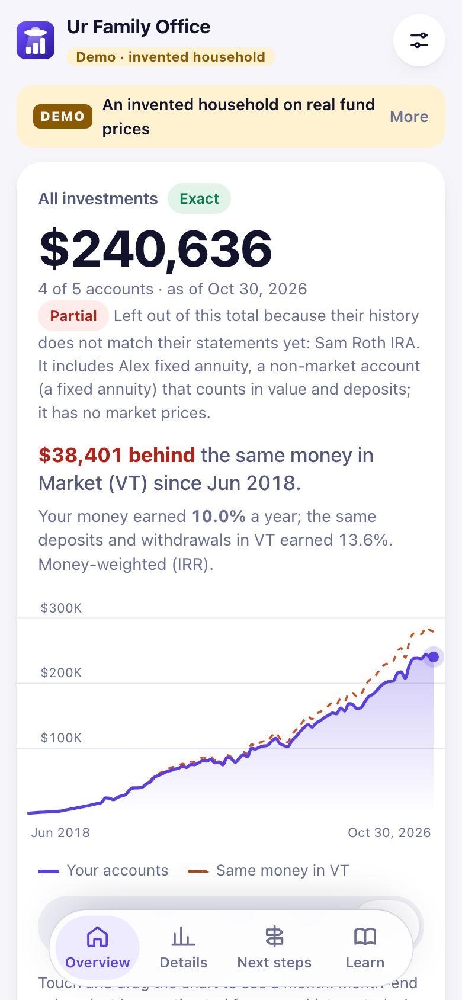

# Ur Family Office

**Understand what your investments earned—and what the same money could have earned elsewhere.**

Built by [Simmy Hundal](https://github.com/simmyhundal). A working product and an ongoing exercise in turning complicated financial data into an approachable experience.

[Try the calculator](https://simmyhundal.github.io/ur-family-office-site/try/) · [Explore a sample household](https://simmyhundal.github.io/ur-family-office-site/plus-demo/) · [Learn how Sharpe works](https://simmyhundal.github.io/ur-family-office-site/learn/sharpe/)

## For investors

- Compare an investment mix against a benchmark using public fund prices.
- Understand return and risk through short, interactive lessons.
- Explore Plus with an **invented household**, without providing account files.

The public calculator processes your inputs in your browser. Its calculations do not require uploading a portfolio. The optional early-access form separately submits the contact information and consent you provide; see [Privacy](https://simmyhundal.github.io/ur-family-office-site/privacy/).

<a href="https://simmyhundal.github.io/ur-family-office-site/plus-demo/"></a>

*Public demo screenshot. Invented account data; real fund prices.*

## What this project demonstrates

I’m building the product across its user experience, implementation, data pipeline and deployment. A few decisions show how I approach that work:

| Challenge | Approach | Public evidence |
|---|---|---|
| Make a technical comparison understandable | Searchable fund names, persistent descriptions and a benchmark users can identify | [Fund picker](site/js/fund-picker.mjs) |
| Explain the numbers | A guided lesson with one idea per step, worked examples and progressive disclosure | [Lesson components](site/js/lesson.mjs) |
| Keep interactive finance usable | Separate calculation logic from presentation and keep calculations in the browser | [Calculation module](site/js/calc.mjs) |
| Ship a small, maintainable product | Static pages, native JavaScript modules and SVG rather than requiring a server for every interaction | [Website source](site/) |
| Keep published data and assets current | Scheduled price updates, guarded publication and asset versioning | [Price pipeline](scripts/fetch_site_prices.py), [deployment workflow](.github/workflows/site.yml) |

**Product judgment and iteration.** Phone reviews and screenshot feedback drive concrete changes: clearer comparisons, less copy, meaningful missing-data states and a consistent visual language. I keep estimates and limitations explicit instead of presenting incomplete information as certainty.

**AI-assisted building with verification.** I use coding agents to accelerate implementation, then review the output against explicit acceptance criteria and automated checks. The companion Plus work includes legacy fallbacks and rollback checks so a migration can be evaluated before it replaces an established experience.

## Architecture and current scope

This repository contains the **public static website**: HTML, CSS, JavaScript modules and SVG, hosted on GitHub Pages. Python scripts fetch public price data during publishing. GitHub Actions publishes on changes and refreshes prices on weekdays.

The companion **Plus Mission Control** product handles local account imports and Python financial calculations in a separate private codebase. Its interactive frontend is being migrated incrementally to **React and TypeScript**, starting with Overview and Details while preserving the existing data contract and recovery path. That migration is not yet the frontend shipped by this public repository.

Personal account exports, credentials and private portfolio reports do not belong here. Public examples use invented accounts. Plus availability and installation remain early-access work; the sample is an exploration, not a public self-serve installer.

## Run the public site locally

From a clone of this repository:

```sh
python3 -m venv .venv
source .venv/bin/activate
python -m pip install 'pydantic>=2.7'
python scripts/fetch_site_prices.py
python -m http.server 8000
```

Open [localhost:8000/site/](http://localhost:8000/site/). Price generation requires internet access. There is no frontend package-install or build step for the current public site.

**Information, not investment advice.** Results are before taxes and trading costs; historical performance does not predict future results.
